# Blueprint

Every section of the measured pages, top to bottom. Build the same kinds of sections in the same order for your product. "Made of" is what fills the section; recreate each block in kind (your content, the source's grammar). Crops are in `assets/reference/sections/`.

## UI grammar (product mock-ups)
Measured inside 6 product UI panels. Build mock-ups as real HTML with these numbers, never as a picture or an empty box.

| what | measured |
|---|---|
| panel surface | background rgb(251, 251, 249), radius 22px, border 1px rgb(228, 228, 223), shadow lab(100 0 0 / 0.9) 0px 1px 0px 0px inset, lab(0 0 0 / 0.05) 0px 1px 2px 0px |
| label sizes (px, count) | 12 (21), 11 (18), 14 (8), 10 (6), 13 (4), 12.5 (2) |
| list row heights (px, count) | 32 (6), 28 (5), 41 (3), 52 (1), 48 (1), 30 (1) |
| icon sizes (px, count) | 16 (13), 14 (7), 12 (4) |
| avatar | — |
| chips | 28px tall, radius 3.35544e+07px, 500 10px; e.g. Mobile base · A · Completed · Completed · Completed · Simulation |
| sidebar width | — |
| text colours (count) | lab(8.36 -0.00000745058 0) (18), lab(43.16 0 0) (18), rgb(110, 110, 105) (6), rgb(23, 23, 23) (3), rgb(242, 242, 242) (3) |
| status colours | #00a63e, #008859, #e9a83a, #28c840, #0c8457 |

## home — 6740px, 6 sections, visuals 42%, 34 elements/screen

### 01 · hero + product UI
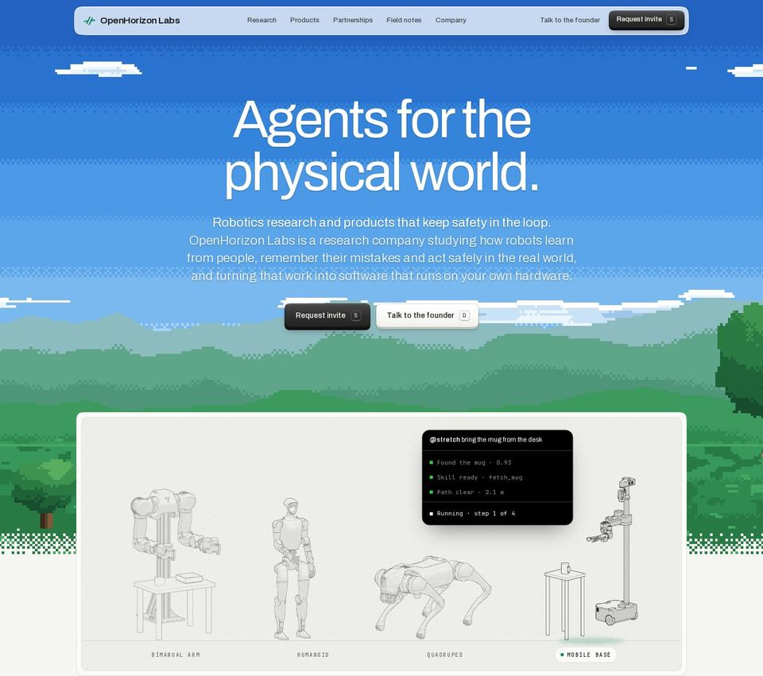
- layout: **hero**; 1276px tall; visuals cover 100%; 25 painted elements
- heading: “Agents for the physical world.” — 100px / 400, at x 272, 896px wide
- made of: **image** (1860×1046, at -210/0/1860/1046); **image** (1860×1046, at -937/0/1860/1046); **image** (1860×1046, at 923/0/1860/1046); **image** (1860×1046, at -1374/0/1860/1046); **image** (1860×1046, at 487/0/1860/1046); **image** (1860×1046, at -210/0/1860/1046); **image** (183×289, at 235/922/183/289); **image** (88×326, at 509/885/88/326); **image** (247×163, at 688/1048/247/163); **image** (179×311, at 1026/900/179/311); **ui-mock** (9 UI labels (panel), at 153/787/1134/480); **ui-mock** (9 UI labels (panel), at 144/778/1152/498)

### 02 · content
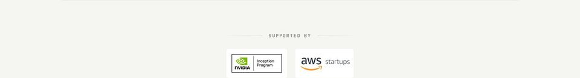
- layout: **stacked**; 193px tall; visuals cover 0%; 3 painted elements
- made of: text only (12 characters)

### 03 · product UI showcase
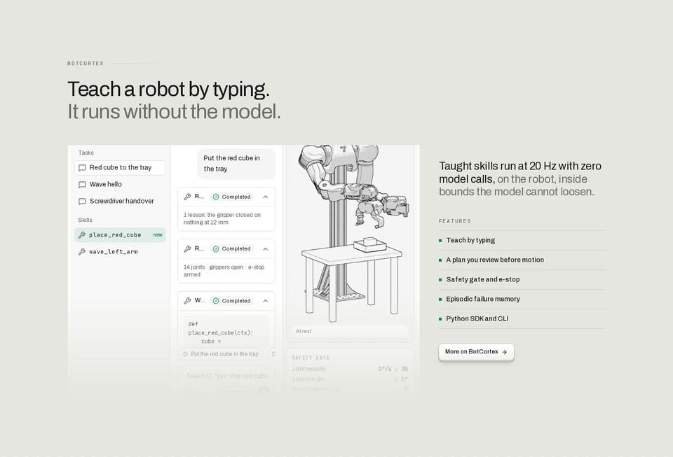
- layout: **stacked**; 980px tall; visuals cover 38%; 109 painted elements
- heading: “Teach a robot by typing.” — 44px / 400, at x 144, 672px wide
- made of: **ui-mock** (33 UI labels, 24 icons, ~22 rows, at 363/1831/243/628); **ui-mock** (58 UI labels, 30 icons, ~34 rows, at 151/1825/741/640); **ui-mock** (58 UI labels, 30 icons, ~34 rows, at 144/1818/755/654); **form** (inputs, at 20/1621/1400/980)

### 04 · testimonials
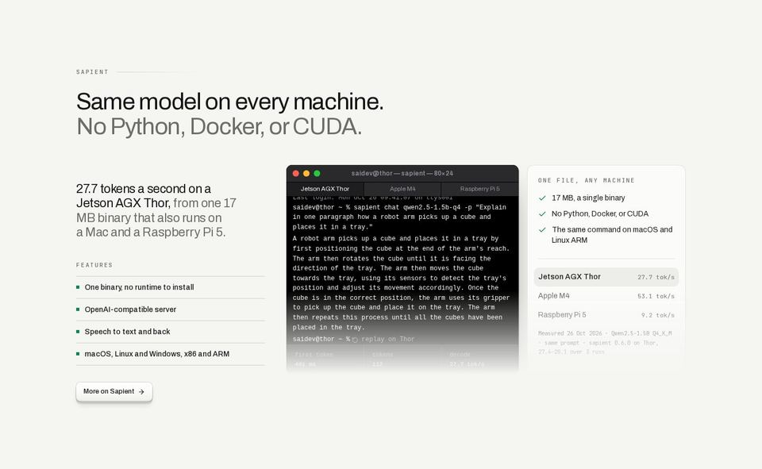
- layout: **stacked**, 2 columns; 887px tall; visuals cover 11%; 58 painted elements
- heading: “Same model on every machine.” — 44px / 400, at x 144, 672px wide
- made of: **code** (6 mono lines, at 541/2996/439/280); **testimonial** (2 × 439×396, quotes, at 541/2936/755/396)

### 05 · content
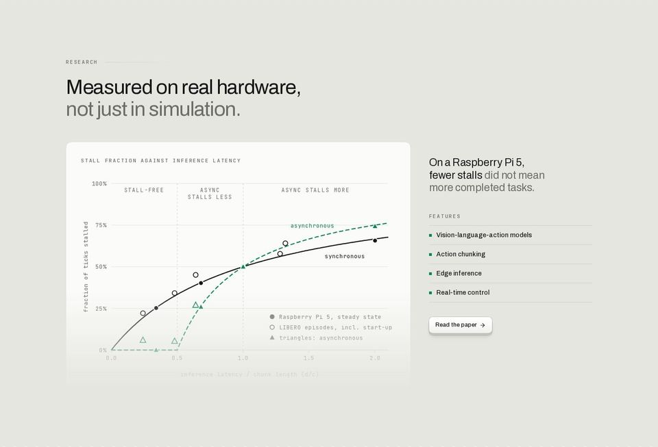
- layout: **stacked**; 980px tall; visuals cover 25%; 23 painted elements
- heading: “Measured on real hardware,” — 44px / 400, at x 144, 672px wide
- made of: **illustration** (svg, 34 shapes, at 177/3912/689/459)

### 06 · testimonials
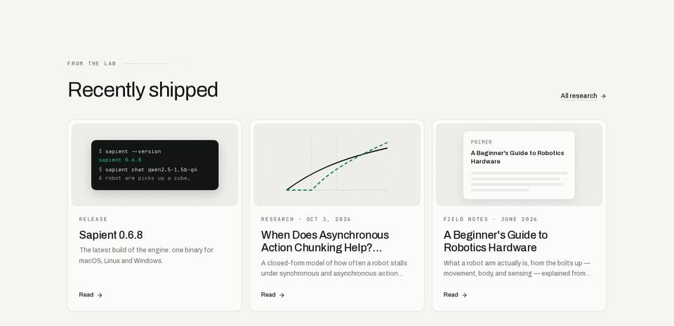
- layout: **stacked**; 698px tall; visuals cover 17%; 40 painted elements
- heading: “Recently shipped” — 44px / 400, at x 144, 322px wide
- made of: **code** (6 mono lines, at 195/4838/272/108); **testimonial** (quote card 373×410, rgb(251, 251, 249), at 533/4794/373/410); **ui-mock** (9 UI labels (panel), at 144/4794/373/410)

## research — 2179px, 3 sections, visuals 57%, 9 elements/screen

### 01 · hero + visual
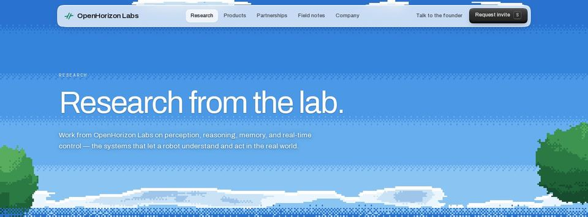
- layout: **hero**; 532px tall; visuals cover 100%; 4 painted elements
- heading: “Research from the lab.” — 76px / 400, at x 144, 854px wide
- made of: **image** (1440×563, at 0/-30/1440/563); **image** (1440×563, at -519/-30/1440/563); **image** (1440×563, at 921/-30/1440/563); **image** (1440×563, at -831/-30/1440/563); **image** (1440×563, at 609/-30/1440/563); **image** (1440×563, at 0/-30/1440/563)

### 02 · testimonials
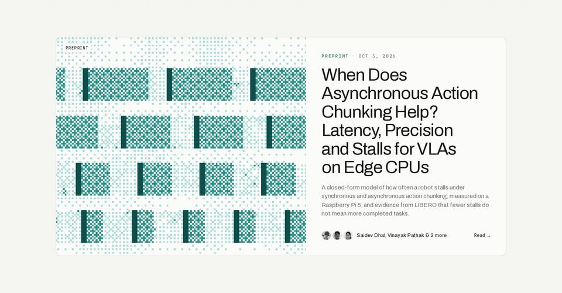
- layout: **stacked**; 752px tall; visuals cover 35%; 14 painted elements
- made of: **image** (640×560, at 144/628/640/560); **avatar** (24px, at 824/1124/24/24); **avatar** (24px, at 852/1124/24/24); **avatar** (24px, at 880/1124/24/24); **testimonial** (quote card 1152×560, rgb(251, 251, 249), at 144/628/1152/560)

### 03 · statement
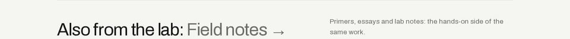
- layout: **split**; 99px tall; visuals cover 0%; 4 painted elements
- heading: “Also from the lab:” — 44px / 400, at x 144, 625px wide
- made of: text only (97 characters)

## products — 3140px, 3 sections, visuals 72%, 16 elements/screen

### 01 · hero + visual
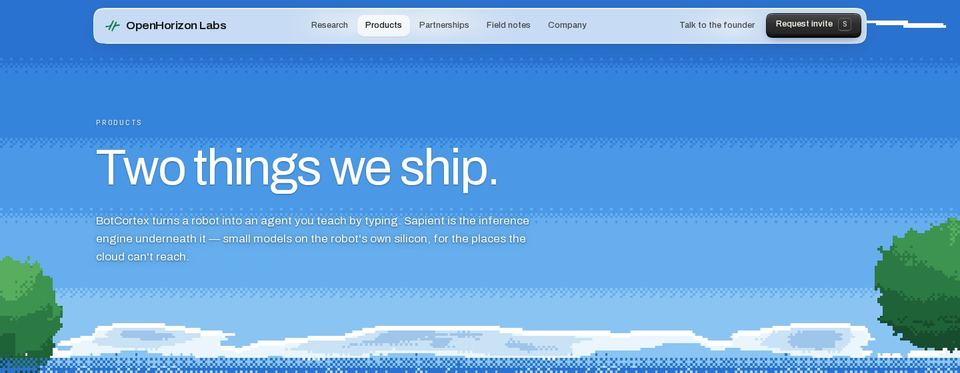
- layout: **hero**; 560px tall; visuals cover 100%; 4 painted elements
- heading: “Two things we ship.” — 76px / 400, at x 144, 854px wide
- made of: **image** (1440×563, at 0/-3/1440/563); **image** (1440×563, at -383/-3/1440/563); **image** (1440×563, at 1057/-3/1440/563); **image** (1440×563, at -613/-3/1440/563); **image** (1440×563, at 827/-3/1440/563); **image** (1440×563, at 0/-3/1440/563)

### 02 · product UI showcase
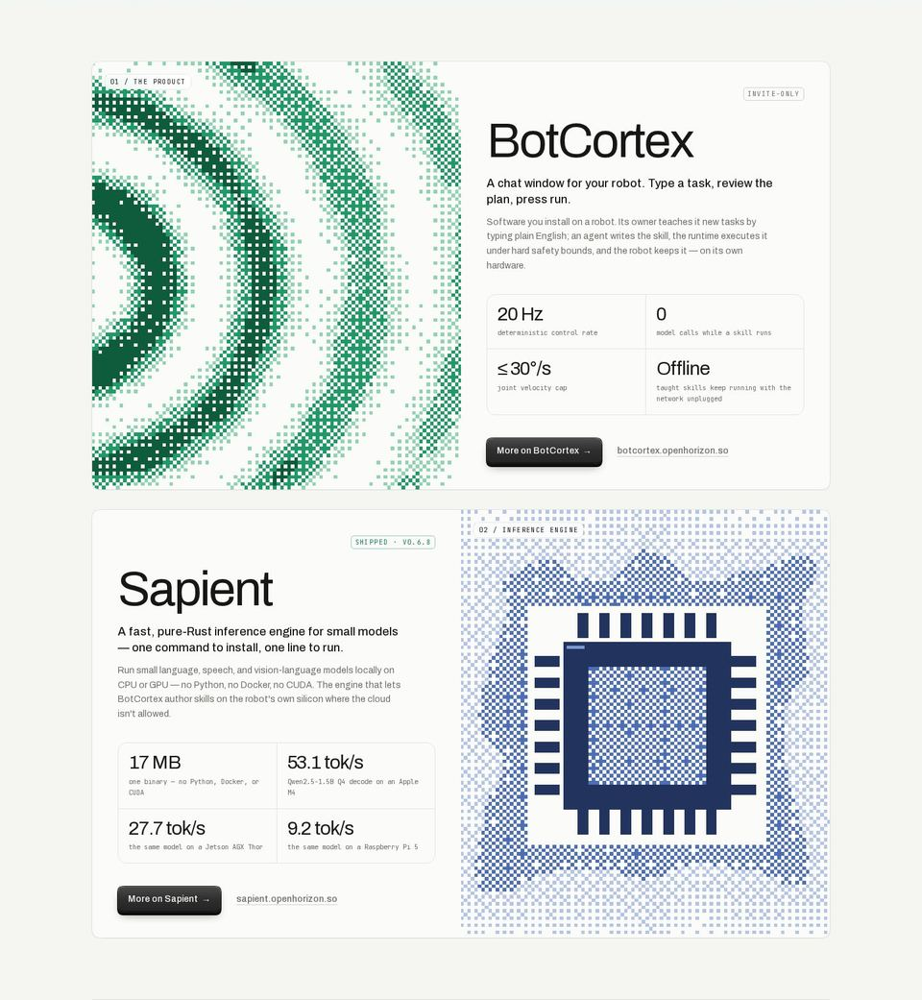
- layout: **stacked**, 2 columns; 1561px tall; visuals cover 72%; 48 painted elements
- made of: **image** (576×668, at 144/656/576/668); **image** (576×668, at 720/1356/576/668); **cards** (2 × 576×668, at 144/656/1152/668); **cards** (2 × 247×102, at 761/1105/495/102); **cards** (2 × 576×668, at 144/1356/1152/668); **cards** (2 × 247×102, at 185/1720/495/102); **ui-mock** (10 UI labels (panel), at 144/656/1152/668); **ui-mock** (10 UI labels (panel), at 144/1356/1152/668)

### 03 · statement
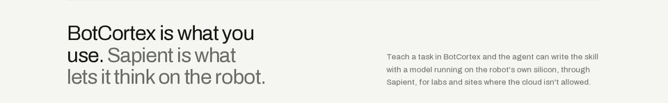
- layout: **split**; 224px tall; visuals cover 0%; 4 painted elements
- heading: “BotCortex is what you use.” — 44px / 400, at x 144, 625px wide
- made of: text only (244 characters)

## partnerships — 7883px, 9 sections, visuals 11%, 27 elements/screen

### 01 · hero + visual
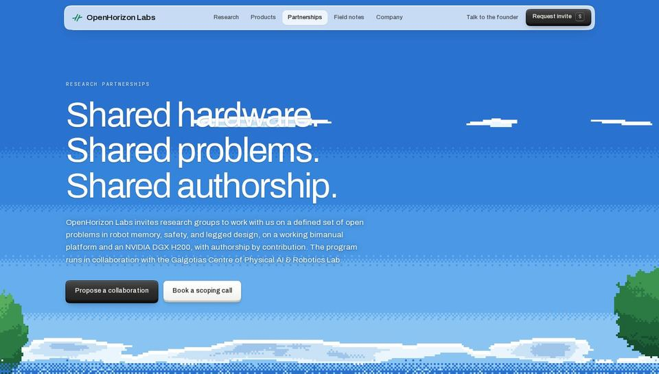
- layout: **hero**; 818px tall; visuals cover 76%; 6 painted elements
- heading: “Shared hardware. Shared problems. Shared authorship.” — 76px / 400, at x 144, 854px wide
- made of: **image** (1512×591, at -36/227/1512/591); **image** (1512×591, at -465/227/1512/591); **image** (1512×591, at 1047/227/1512/591); **image** (1512×591, at -723/227/1512/591); **image** (1512×591, at 789/227/1512/591); **image** (1512×591, at -36/227/1512/591)

### 02 · content
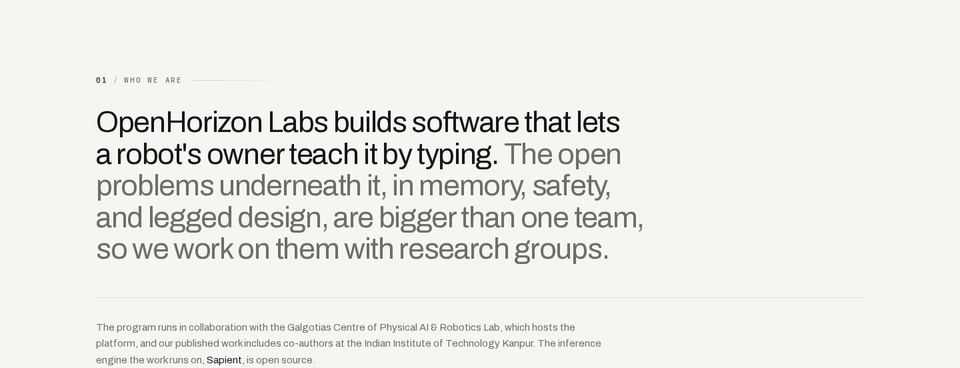
- layout: **stacked**; 552px tall; visuals cover 0%; 8 painted elements
- heading: “OpenHorizon Labs builds software that lets a robot's owner teach it by typing.” — 44px / 400, at x 144, 896px wide
- made of: text only (496 characters)

### 03 · card row
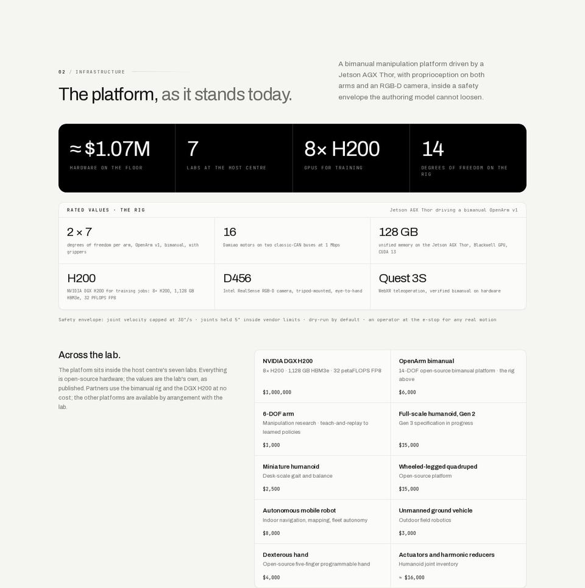
- layout: **split**, 10 columns; 1448px tall; visuals cover 0%; 85 painted elements
- heading: “The platform,” — 44px / 400, at x 144, 625px wide
- made of: **cards** (2 × 1152×169, at 144/1675/1152/459); **cards** (4 × 287×169, at 144/1675/1152/169); **cards** (6 × 383×113, at 145/1906/1150/227); **cards** (10 × 333×129, at 627/2232/668/585)

### 04 · card row
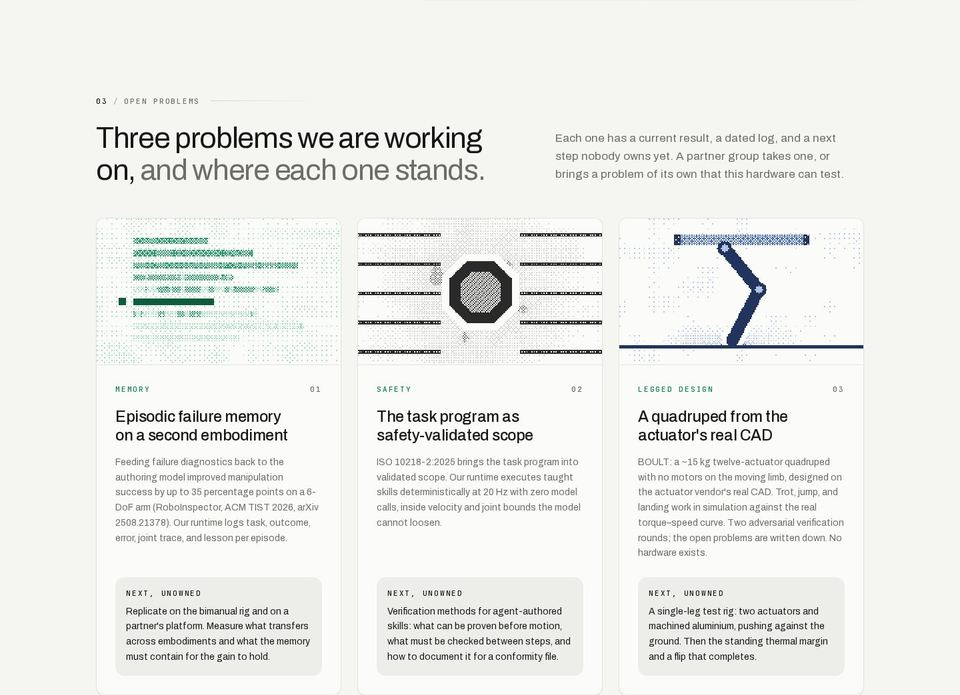
- layout: **split**, 3 columns; 1043px tall; visuals cover 18%; 33 painted elements
- heading: “Three problems we are working on,” — 44px / 400, at x 144, 625px wide
- made of: **image** (366×219, at 145/3146/366/219); **image** (366×219, at 537/3146/366/219); **image** (366×219, at 929/3146/366/219); **cards** (3 × 368×716, at 144/3145/1152/716)

### 05 · card row
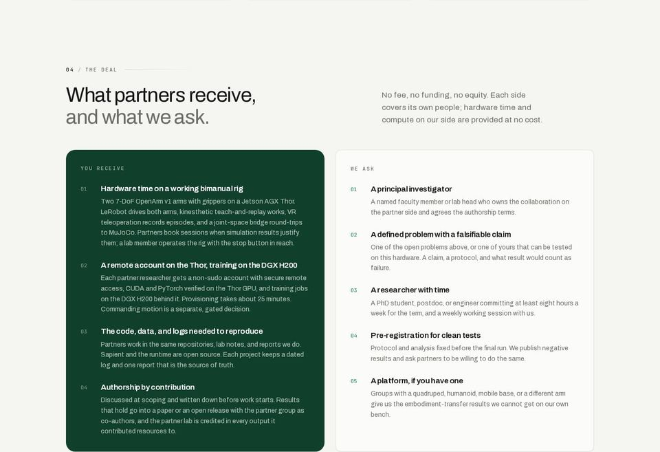
- layout: **split**, 2 columns; 986px tall; visuals cover 0%; 37 painted elements
- heading: “What partners receive,” — 44px / 400, at x 144, 625px wide
- made of: **cards** (2 × 564×658, at 144/4188/1152/658)

### 06 · card row
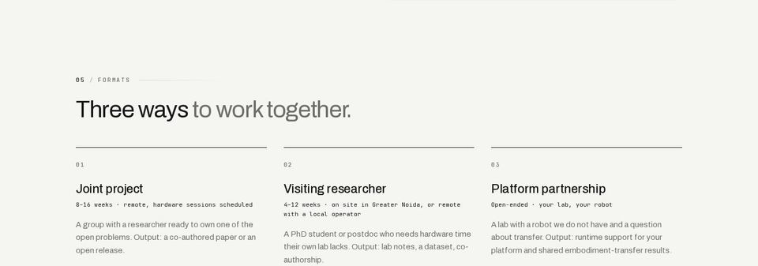
- layout: **columns**, 3 columns; 506px tall; visuals cover 0%; 20 painted elements
- heading: “Three ways” — 44px / 400, at x 144, 625px wide
- made of: **cards** (3 × 363×226, at 144/5126/1152/226)

### 07 · content
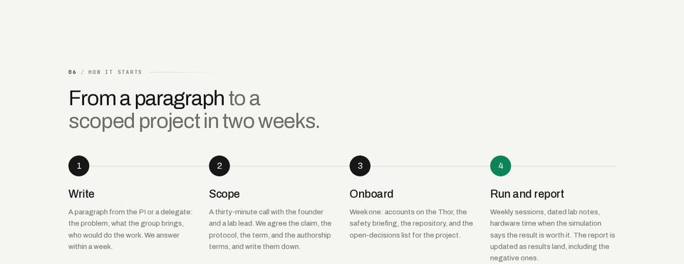
- layout: **stacked**; 557px tall; visuals cover 0%; 18 painted elements
- heading: “From a paragraph” — 44px / 400, at x 144, 625px wide
- made of: text only (643 characters)

### 08 · statement
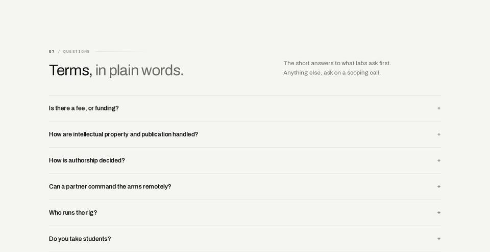
- layout: **split**; 743px tall; visuals cover 0%; 19 painted elements
- heading: “Terms,” — 44px / 400, at x 144, 625px wide
- made of: text only (303 characters)

### 09 · call to action
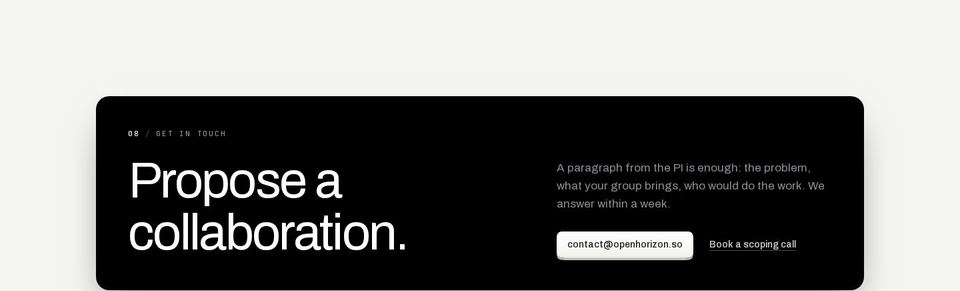
- layout: **split**; 436px tall; visuals cover 0%; 8 painted elements
- heading: “Propose a collaboration.” — 76px / 400, at x 192, 579px wide
- made of: text only (199 characters)
