# Components

Each variant is the clustered style of every element that looked the same across the crawled pages. Classes of the same name are in `assets/tokens.css`. Crops are in `assets/reference/`.

## link (link, ×60)

Examples: “BotCortex — the product”, “Sapient — inference engine”, “All products”, “Docs”

| property | value |
|---|---|
| background | `transparent` |
| color | `rgb(255 255 255 / 0.9)` |
| font | `400 14px/20px` |
| family | `Archivo` |
| padding | `0px 0px 0px 0px` |
| transition | `color 0.34s cubic-bezier(0.22, 1, 0.36, 1), background-color 0.34s cubic-bezier(0.22, 1, 0.36, 1), border-color 0.34s cubic-bezier(0.22, 1, 0.36, 1), outline-color 0.34s cubic-bezier(0.22, 1, 0.36, 1), text-decoration-color 0.34s cubic-bezier(0.22, 1, 0.36, 1), fill 0.34s cubic-bezier(0.22, 1, 0.36, 1), stroke 0.34s cubic-bezier(0.22, 1, 0.36, 1), --tw-gradient-from 0.34s cubic-bezier(0.22, 1, 0.36, 1), --tw-gradient-via 0.34s cubic-bezier(0.22, 1, 0.36, 1), --tw-gradient-to 0.34s cubic-bezier(0.22, 1, 0.36, 1)` |
| cursor | `pointer` |
Size: 15px tall, from 35px wide, padding 0px × 0px.

**Hover**
| property | rest | hover |
|---|---|---|
| color | `oklab(0.999994 0.0000455678 0.0000200868 / 0.9)` | `rgb(255, 255, 255)` |
| textDecorationLine | `none` | `underline` |
| outlineColor | `oklab(0.999994 0.0000455678 0.0000200868 / 0.9)` | `rgb(255, 255, 255)` |
Transitions: color 340ms cubic-bezier(0.22, 1, 0.36, 1)
Inside it: span.tone-2.transition-colors “Field notes →” 254×48 — color 340ms cubic-bezier(0.22, 1, 0.36, 1); span.tone-2.transition-colors “Field notes →” 254×48 — color 134ms cubic-bezier(0.22, 1, 0.36, 1)

**Focus-visible**: outline `1px auto rgba(255, 255, 255, 0.9)`, offset 1px

## link-2 (link, ×21)

Examples: “Research”, “Products”, “Partnerships”, “Field notes”

| property | value |
|---|---|
| background | `transparent` |
| color | `rgb(23 23 23 / 0.75)` |
| radius | `10px` |
| font | `500 13px/19.5px` |
| family | `Archivo` |
| padding | `6px 12px 6px 12px` |
| transition | `color 0.34s cubic-bezier(0.22, 1, 0.36, 1), background-color 0.34s cubic-bezier(0.22, 1, 0.36, 1), border-color 0.34s cubic-bezier(0.22, 1, 0.36, 1), outline-color 0.34s cubic-bezier(0.22, 1, 0.36, 1), text-decoration-color 0.34s cubic-bezier(0.22, 1, 0.36, 1), fill 0.34s cubic-bezier(0.22, 1, 0.36, 1), stroke 0.34s cubic-bezier(0.22, 1, 0.36, 1), --tw-gradient-from 0.34s cubic-bezier(0.22, 1, 0.36, 1), --tw-gradient-via 0.34s cubic-bezier(0.22, 1, 0.36, 1), --tw-gradient-to 0.34s cubic-bezier(0.22, 1, 0.36, 1)` |
| cursor | `pointer` |
Size: 32px tall, from 79px wide, padding 6px × 12px.

**Hover**
| property | rest | hover |
|---|---|---|
| color | `oklab(0.204625 0.00000931323 0.00000409782 / 0.75)` | `rgb(23, 23, 23)` |
| backgroundColor | `rgba(0, 0, 0, 0)` | `oklab(0.999994 0.0000455678 0.0000200868 / 0.5)` |
| outlineColor | `oklab(0.204625 0.00000931323 0.00000409782 / 0.75)` | `rgb(23, 23, 23)` |
Transitions: backgroundColor 340ms cubic-bezier(0.22, 1, 0.36, 1); color 340ms cubic-bezier(0.22, 1, 0.36, 1)
Inside it: div.grid.transition-[grid-template-rows] 284×96 — gridTemplateRows 500ms cubic-bezier(0, 0, 0.2, 1); span.mono.absolute “Loading the map…” — filter 300ms cubic-bezier(0.22, 1, 0.36, 1); span.mono.absolute “Loading the map…” — opacity 300ms cubic-bezier(0.22, 1, 0.36, 1); span.mono.absolute “Loading the map…” — filter 300ms cubic-bezier(0.22, 1, 0.36, 1); span.mono.absolute “Loading the map…” — opacity 300ms cubic-bezier(0.22, 1, 0.36, 1); span.mono.absolute “Map loaded · 3 doors” — filter 300ms cubic-bezier(0.22, 1, 0.36, 1)

**Focus-visible**: outline `1px auto rgba(23, 23, 23, 0.75)`, offset 1px

## link-3 (link, ×12)

Examples: “Company details”, “Policies”, “contact@openhorizon.so”

| property | value |
|---|---|
| background | `transparent` |
| color | `rgb(255 255 255 / 0.9)` |
| radius | `4px` |
| font | `400 12px/16px` |
| family | `Archivo` |
| padding | `2px 8px 2px 8px` |
| transition | `color 0.34s cubic-bezier(0.22, 1, 0.36, 1), background-color 0.34s cubic-bezier(0.22, 1, 0.36, 1), border-color 0.34s cubic-bezier(0.22, 1, 0.36, 1), outline-color 0.34s cubic-bezier(0.22, 1, 0.36, 1), text-decoration-color 0.34s cubic-bezier(0.22, 1, 0.36, 1), fill 0.34s cubic-bezier(0.22, 1, 0.36, 1), stroke 0.34s cubic-bezier(0.22, 1, 0.36, 1), --tw-gradient-from 0.34s cubic-bezier(0.22, 1, 0.36, 1), --tw-gradient-via 0.34s cubic-bezier(0.22, 1, 0.36, 1), --tw-gradient-to 0.34s cubic-bezier(0.22, 1, 0.36, 1)` |
| cursor | `pointer` |
Size: 20px tall, from 59px wide, padding 2px × 8px.

**Hover**
| property | rest | hover |
|---|---|---|
| color | `oklab(0.999994 0.0000455678 0.0000200868 / 0.9)` | `rgb(255, 255, 255)` |
| backgroundColor | `rgba(0, 0, 0, 0)` | `oklab(0.999994 0.0000455678 0.0000200868 / 0.15)` |
| outlineColor | `oklab(0.999994 0.0000455678 0.0000200868 / 0.9)` | `rgb(255, 255, 255)` |
Transitions: backgroundColor 340ms cubic-bezier(0.22, 1, 0.36, 1); color 340ms cubic-bezier(0.22, 1, 0.36, 1)

**Focus-visible**: outline `1px auto rgba(255, 255, 255, 0.9)`, offset 1px

## card (card, ×28)
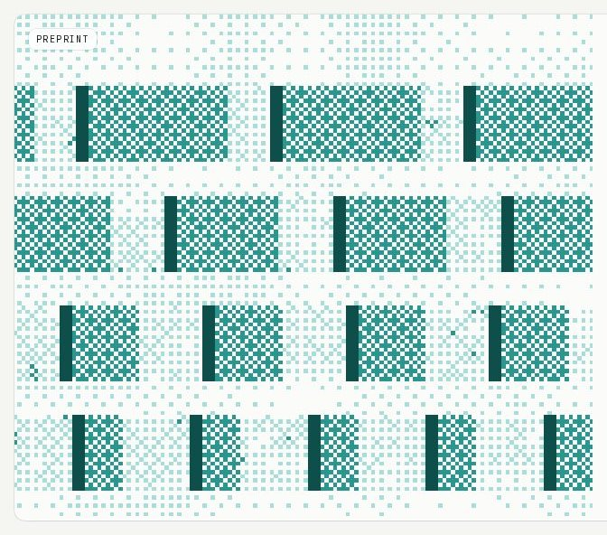

| property | value |
|---|---|
| background | `#fbfbf9` |
| color | `#171717` |
| font | `400 16px/24px` |
| family | `Archivo` |
| padding | `0px 0px 0px 0px` |
| cursor | `pointer` |
Size: 560px tall, from 247px wide, padding 0px × 0px.

**Hover**
| property | rest | hover |
|---|---|---|

Inside it: a.card-art.group 1152×560 — translate 300ms cubic-bezier(0.22, 1, 0.36, 1); img.absolute.inset-0 640×560 — scale 700ms cubic-bezier(0, 0, 0.2, 1); span.transition-transform.group-hover:translate-x-0.5 “→” 7×16 — translate 340ms cubic-bezier(0.22, 1, 0.36, 1)

## card-2 (card, ×10)
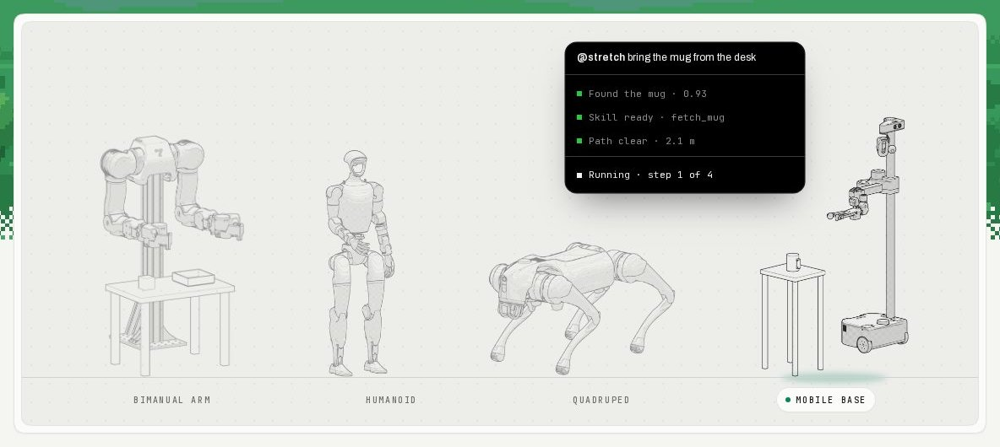

| property | value |
|---|---|
| background | `#fbfbf9` |
| color | `#171717` |
| border | `1px solid #e4e4df` |
| radius | `22px` |
| shadow | `lab(100 0 0 / 0.9) 0px 1px 0px 0px inset, lab(0 0 0 / 0.05) 0px 1px 2px 0px` |
| font | `400 16px/24px` |
| family | `Archivo` |
| padding | `8px 8px 8px 8px` |
Size: 498px tall, from 300px wide, padding 8px × 8px.

**Hover**
| property | rest | hover |
|---|---|---|

Inside it: div.flex.w-full 305×108 — translate 500ms cubic-bezier(0.22, 1, 0.36, 1); svg.lucide.lucide-arrow-right 14×14 — translate 340ms cubic-bezier(0.22, 1, 0.36, 1); span.absolute.-bottom-1.5 173×12 — backgroundColor 500ms cubic-bezier(0.22, 1, 0.36, 1); span.absolute.-bottom-1.5 173×12 — filter 500ms cubic-bezier(0.22, 1, 0.36, 1); span.absolute.-bottom-1.5 173×12 — opacity 500ms cubic-bezier(0.22, 1, 0.36, 1); span.relative.block 247×163 — filter 500ms cubic-bezier(0.22, 1, 0.36, 1)

**Focus-visible**: outline `1px auto rgb(16, 16, 16)`, offset 1px, shadow `lab(100 0 0 / 0.9) 0px 1px 0px 0px inset, lab(0 0 0 / 0.05) 0px 1px 2px 0px`

## card-3 (card, ×4)
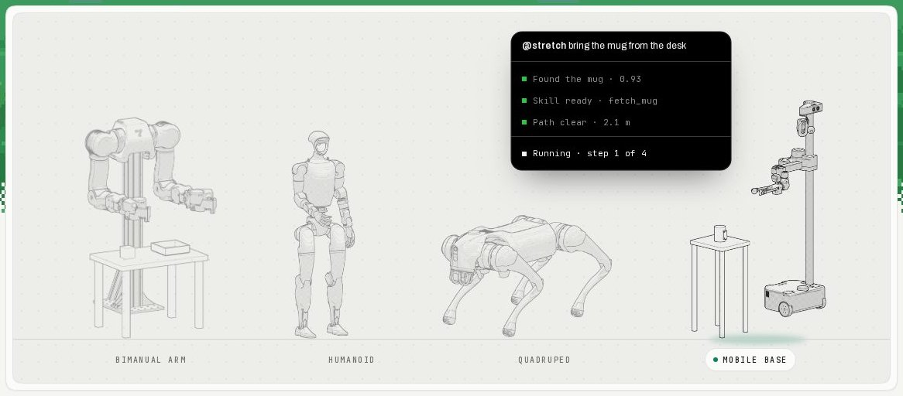

| property | value |
|---|---|
| background | `radial-gradient(lab(0 0 0 / 0.05) 1.1px, rgba(0, 0, 0, 0) 1.1px)` |
| color | `#171717` |
| border | `1px solid #e4e4df` |
| radius | `20px` |
| font | `400 16px/24px` |
| family | `Archivo` |
| padding | `0px 0px 0px 0px` |
Size: 480px tall, from 355px wide, padding 0px × 0px.

## card-4 (card, ×4)
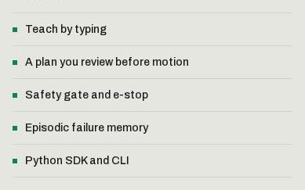

| property | value |
|---|---|
| background | `transparent` |
| color | `#171717` |
| border | `1px solid #d2d2cc` |
| font | `400 16px/24px` |
| family | `Archivo` |
| padding | `0px 0px 0px 0px` |
Size: 211px tall, from 357px wide, padding 0px × 0px.

## card-5 (card, ×4)
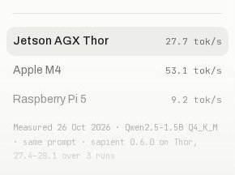

| property | value |
|---|---|
| background | `transparent` |
| color | `#171717` |
| border | `1px solid #e4e4df` |
| font | `400 16px/24px` |
| family | `Archivo` |
| padding | `16px 0px 0px 0px` |
Size: 184px tall, from 258px wide, padding 16px × 0px.

**Hover**
| property | rest | hover |
|---|---|---|

Inside it: a.card-art.group 1152×560 — translate 300ms cubic-bezier(0.22, 1, 0.36, 1); img.absolute.inset-0 640×560 — scale 700ms cubic-bezier(0, 0, 0.2, 1); span.transition-transform.group-hover:translate-x-0.5 “→” 7×16 — translate 340ms cubic-bezier(0.22, 1, 0.36, 1); a.card-art.group 1152×560 — translate 215ms cubic-bezier(0.22, 1, 0.36, 1); img.absolute.inset-0 640×560 — scale 205ms cubic-bezier(0, 0, 0.2, 1); span.transition-transform.group-hover:translate-x-0.5 “→” 7×16 — translate 226ms cubic-bezier(0.22, 1, 0.36, 1)

**Focus-visible**: outline `1px auto rgb(16, 16, 16)`, offset 1px

## card-6 (card, ×4)
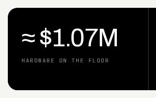

| property | value |
|---|---|
| background | `#000000` |
| color | `#f2f2f2` |
| font | `400 16px/24px` |
| family | `Archivo` |
| padding | `36px 28px 36px 28px` |
Size: 169px tall, from 287px wide, padding 36px × 28px.

## card-7 (card, ×3)
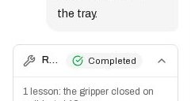

| property | value |
|---|---|
| background | `transparent` |
| color | `#181818` |
| border | `1px solid #dfdfdf` |
| radius | `8px` |
| font | `400 16px/24px` |
| family | `Archivo` |
| padding | `0px 0px 0px 0px` |
Size: 96px tall, from 209px wide, padding 0px × 0px.

## card-8 (card, ×3)
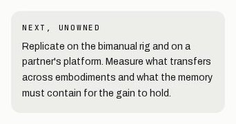

| property | value |
|---|---|
| background | `#ededea` |
| color | `#171717` |
| radius | `14px` |
| font | `400 16px/24px` |
| family | `Archivo` |
| padding | `16px 16px 16px 16px` |
Size: 148px tall, from 310px wide, padding 16px × 16px.

## button-outline (button, ×5)
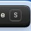
Examples: “S”

| property | value |
|---|---|
| background | `transparent` |
| color | `rgb(245 245 242 / 0.78)` |
| border | `1px solid rgb(245 245 242 / 0.218)` |
| radius | `5px` |
| font | `500 11px/11px` |
| family | `JetBrains Mono` |
| padding | `0px 4.8px 0px 4.8px` |
| cursor | `pointer` |
Size: 20px tall, from 20px wide, padding 0px × 4.8px.

**Hover**
| property | rest | hover |
|---|---|---|

Inside it: a.rounded-[10px].px-3 “Company” 82×32 — backgroundColor 340ms cubic-bezier(0.22, 1, 0.36, 1); a.rounded-[10px].px-3 “Company” 82×32 — color 340ms cubic-bezier(0.22, 1, 0.36, 1); a.hidden.shrink-0 “Talk to the founder” 137×36 — backgroundColor 340ms cubic-bezier(0.22, 1, 0.36, 1); a.hidden.shrink-0 “Talk to the founder” 137×36 — color 340ms cubic-bezier(0.22, 1, 0.36, 1); button.btn-raised-dark.relative “Request invite” 141×32 — boxShadow 120ms cubic-bezier(0.2, 0.8, 0.2, 1); button.btn-raised-dark.relative “Request invite” 141×32 — filter 160ms ease

## button-secondary (button, ×5)

Examples: “Request invite”, “More on BotCortex”, “More on Sapient”, “Propose a collaboration”

| property | value |
|---|---|
| background | `linear-gradient(rgb(74, 74, 74) 0%, rgb(46, 46, 46) 50%, rgb(35, 35, 35) 100%)` |
| color | `#f5f5f2` |
| radius | `15px` |
| shadow | `lab(100 0 0 / 0.22) 0px 1px 0px 0px inset, lab(0 0 0 / 0.35) 0px -2px 0px 0px inset, rgb(20, 20, 20) 0px 0px 0px 1px, rgb(15, 15, 15) 0px 3px 0px 0px, rgb(10, 10, 10) 0px 4px 0px 1px, lab(0 0 0 / 0.38) 0px 9px 14px -4px` |
| font | `500 14px/20px` |
| family | `Archivo` |
| padding | `0px 20px 0px 20px` |
| transition | `translate 0.12s cubic-bezier(0.2, 0.8, 0.2, 1), box-shadow 0.12s cubic-bezier(0.2, 0.8, 0.2, 1), filter 0.16s ease` |
| cursor | `pointer` |
Size: 44px tall, from 134px wide, padding 0px × 20px.

**Hover**
| property | rest | hover |
|---|---|---|
| boxShadow | `lab(100 0 0 / 0.22) 0px 1px 0px 0px inset, lab(0 0 0 / 0.35) 0px -2px 0px 0px inset, rgb(20, 20, 20) 0px 0px 0px 1px, rgb(15, 15, 15) 0px 3px 0px 0px, rgb(10, 10, 10) 0px 4px 0px 1px, lab(0 0 0 / 0.38) 0px 9px 14px -4px` | `lab(100 0 0 / 0.22) 0px 1px 0px 0px inset, lab(0 0 0 / 0.35) 0px -2px 0px 0px inset, rgb(20, 20, 20) 0px 0px 0px 1px, rgb(15, 15, 15) 0px 4px 0px 0px, rgb(10, 10, 10) 0px 5px 0px 1px, lab(0 0 0 / 0.38) 0px 10px 14px -4px` |
| filter | `none` | `brightness(1.12)` |
| translate | `0px` | `0px -1px` |
Transitions: boxShadow 120ms cubic-bezier(0.2, 0.8, 0.2, 1); filter 160ms ease; translate 120ms cubic-bezier(0.2, 0.8, 0.2, 1)

**Focus-visible**: outline `2px solid rgb(12, 132, 87)`, offset 2px, shadow `lab(100 0 0 / 0.22) 0px 1px 0px 0px inset, lab(0 0 0 / 0.35) 0px -2px 0px 0px inset, rgb(20, 20, 20) 0px 0px 0px 1px, rgb(15, 15, 15) 0px 3px 0px 0px, rgb(10, 10, 10) 0px 4px 0px 1px, lab(0 0 0 / 0.38) 0px 9px 14px -4px`

## button-secondary-2 (button, ×4)

Examples: “Request invite”

| property | value |
|---|---|
| background | `linear-gradient(rgb(74, 74, 74) 0%, rgb(46, 46, 46) 50%, rgb(35, 35, 35) 100%)` |
| color | `#f5f5f2` |
| radius | `15px` |
| shadow | `lab(100 0 0 / 0.22) 0px 1px 0px 0px inset, lab(0 0 0 / 0.35) 0px -2px 0px 0px inset, rgb(20, 20, 20) 0px 0px 0px 1px, rgb(15, 15, 15) 0px 2px 0px 0px, rgb(10, 10, 10) 0px 3px 0px 1px, lab(0 0 0 / 0.38) 0px 8px 14px -4px` |
| font | `500 13px/19.5px` |
| family | `Archivo` |
| padding | `0px 14px 0px 14px` |
| gap | `8px` |
| transition | `translate 0.12s cubic-bezier(0.2, 0.8, 0.2, 1), box-shadow 0.12s cubic-bezier(0.2, 0.8, 0.2, 1), filter 0.16s ease` |
| cursor | `pointer` |
Size: 32px tall, from 141px wide, padding 0px × 14px.

**Hover**
| property | rest | hover |
|---|---|---|
| boxShadow | `lab(100 0 0 / 0.22) 0px 1px 0px 0px inset, lab(0 0 0 / 0.35) 0px -2px 0px 0px inset, rgb(20, 20, 20) 0px 0px 0px 1px, rgb(15, 15, 15) 0px 2px 0px 0px, rgb(10, 10, 10) 0px 3px 0px 1px, lab(0 0 0 / 0.38) 0px 8px 14px -4px` | `lab(100 0 0 / 0.22) 0px 1px 0px 0px inset, lab(0 0 0 / 0.35) 0px -2px 0px 0px inset, rgb(20, 20, 20) 0px 0px 0px 1px, rgb(15, 15, 15) 0px 3px 0px 0px, rgb(10, 10, 10) 0px 4px 0px 1px, lab(0 0 0 / 0.38) 0px 9px 14px -4px` |
| filter | `none` | `brightness(1.12)` |
| translate | `0px` | `0px -1px` |
Transitions: boxShadow 120ms cubic-bezier(0.2, 0.8, 0.2, 1); filter 160ms ease; translate 120ms cubic-bezier(0.2, 0.8, 0.2, 1)
Inside it: a.rounded-[10px].px-3 “Company” 82×32 — backgroundColor 340ms cubic-bezier(0.22, 1, 0.36, 1); a.rounded-[10px].px-3 “Company” 82×32 — color 340ms cubic-bezier(0.22, 1, 0.36, 1); a.hidden.shrink-0 “Talk to the founder” 137×36 — backgroundColor 340ms cubic-bezier(0.22, 1, 0.36, 1); a.hidden.shrink-0 “Talk to the founder” 137×36 — color 340ms cubic-bezier(0.22, 1, 0.36, 1); div.h-full.bg-term-max — width 700ms cubic-bezier(0, 0, 0.2, 1)

**Focus-visible**: outline `1px auto rgb(16, 16, 16)`, offset 0px, shadow `lab(100 0 0 / 0.22) 0px 1px 0px 0px inset, lab(0 0 0 / 0.35) 0px -2px 0px 0px inset, rgb(20, 20, 20) 0px 0px 0px 1px, rgb(15, 15, 15) 0px 2px 0px 0px, rgb(10, 10, 10) 0px 3px 0px 1px, lab(0 0 0 / 0.38) 0px 8px 14px -4px`

## button-secondary-3 (button, ×4)
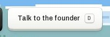
Examples: “Talk to the founder”, “Book a scoping call”, “contact@openhorizon.so”

| property | value |
|---|---|
| background | `linear-gradient(rgb(255, 255, 255) 0%, rgb(250, 250, 248) 50%, rgb(239, 239, 235) 100%)` |
| color | `#171717` |
| radius | `15px` |
| shadow | `lab(100 0 0) 0px 1px 0px 0px inset, lab(0 0 0 / 0.05) 0px -2px 0px 0px inset, lab(13 0 0 / 0.16) 0px 0px 0px 1px, rgb(200, 200, 193) 0px 3px 0px 0px, lab(13 0 0 / 0.1) 0px 4px 0px 1px, lab(0 0 0 / 0.16) 0px 9px 12px -4px` |
| font | `500 14px/20px` |
| family | `Archivo` |
| padding | `0px 20px 0px 20px` |
| transition | `translate 0.12s cubic-bezier(0.2, 0.8, 0.2, 1), box-shadow 0.12s cubic-bezier(0.2, 0.8, 0.2, 1), filter 0.16s ease` |
| cursor | `pointer` |
Size: 44px tall, from 167px wide, padding 0px × 20px.

**Hover**
| property | rest | hover |
|---|---|---|
| boxShadow | `lab(100 0 0) 0px 1px 0px 0px inset, lab(0 0 0 / 0.05) 0px -2px 0px 0px inset, lab(13 0 0 / 0.16) 0px 0px 0px 1px, rgb(200, 200, 193) 0px 3px 0px 0px, lab(13 0 0 / 0.1) 0px 4px 0px 1px, lab(0 0 0 / 0.16) 0px 9px 12px -4px` | `lab(100 0 0) 0px 1px 0px 0px inset, lab(0 0 0 / 0.05) 0px -2px 0px 0px inset, lab(13 0 0 / 0.16) 0px 0px 0px 1px, rgb(200, 200, 193) 0px 4px 0px 0px, lab(13 0 0 / 0.1) 0px 5px 0px 1px, lab(0 0 0 / 0.16) 0px 10px 12px -4px` |
| translate | `0px` | `0px -1px` |
Transitions: boxShadow 120ms cubic-bezier(0.2, 0.8, 0.2, 1); translate 120ms cubic-bezier(0.2, 0.8, 0.2, 1)
Inside it: span.absolute.-bottom-1.5 173×12 — backgroundColor 500ms cubic-bezier(0.22, 1, 0.36, 1); span.absolute.-bottom-1.5 173×12 — filter 500ms cubic-bezier(0.22, 1, 0.36, 1); span.absolute.-bottom-1.5 173×12 — opacity 500ms cubic-bezier(0.22, 1, 0.36, 1); span.relative.block 247×163 — filter 500ms cubic-bezier(0.22, 1, 0.36, 1); span.relative.block 247×163 — opacity 500ms cubic-bezier(0.22, 1, 0.36, 1); span.absolute.-bottom-1.5 125×12 — backgroundColor 500ms cubic-bezier(0.22, 1, 0.36, 1)

**Focus-visible**: outline `2px solid rgb(23, 23, 23)`, offset 2px, shadow `lab(100 0 0) 0px 1px 0px 0px inset, lab(0 0 0 / 0.05) 0px -2px 0px 0px inset, lab(13 0 0 / 0.16) 0px 0px 0px 1px, rgb(200, 200, 193) 0px 3px 0px 0px, lab(13 0 0 / 0.1) 0px 4px 0px 1px, lab(0 0 0 / 0.16) 0px 9px 12px -4px`

## button-primary (button, ×4)
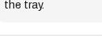
Examples: “Completed”

| property | value |
|---|---|
| background | `#f5f5f5` |
| color | `#181818` |
| radius | `3.35544e+07px` |
| font | `400 11px/16.5px` |
| family | `Archivo` |
| padding | `2px 8px 2px 8px` |
| gap | `6px` |
| cursor | `pointer` |
Size: 21px tall, from 97px wide, padding 2px × 8px.

## button-outline-2 (button, ×3)
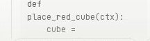
Examples: “Put the red cube in the tray”, “Wave with the left arm”, “Hand me the screwdriver”

| property | value |
|---|---|
| background | `transparent` |
| color | `#484848` |
| border | `1px solid #dfdfdf` |
| radius | `3.35544e+07px` |
| font | `400 12px/16px` |
| family | `Archivo` |
| padding | `0px 10px 0px 10px` |
| gap | `6px` |
| transition | `color 0.34s cubic-bezier(0.22, 1, 0.36, 1), background-color 0.34s cubic-bezier(0.22, 1, 0.36, 1), border-color 0.34s cubic-bezier(0.22, 1, 0.36, 1), outline-color 0.34s cubic-bezier(0.22, 1, 0.36, 1), text-decoration-color 0.34s cubic-bezier(0.22, 1, 0.36, 1), fill 0.34s cubic-bezier(0.22, 1, 0.36, 1), stroke 0.34s cubic-bezier(0.22, 1, 0.36, 1), --tw-gradient-from 0.34s cubic-bezier(0.22, 1, 0.36, 1), --tw-gradient-via 0.34s cubic-bezier(0.22, 1, 0.36, 1), --tw-gradient-to 0.34s cubic-bezier(0.22, 1, 0.36, 1)` |
| cursor | `pointer` |
Size: 28px tall, from 159px wide, padding 0px × 10px.

## navbar (navbar, ×4)

| property | value |
|---|---|
| background | `transparent` |
| color | `#171717` |
| font | `400 16px/24px` |
| family | `Archivo` |
| padding | `12px 20px 0px 20px` |
Size: 76px tall, from 1440px wide, padding 12px × 20px.

## footer (footer, ×4)
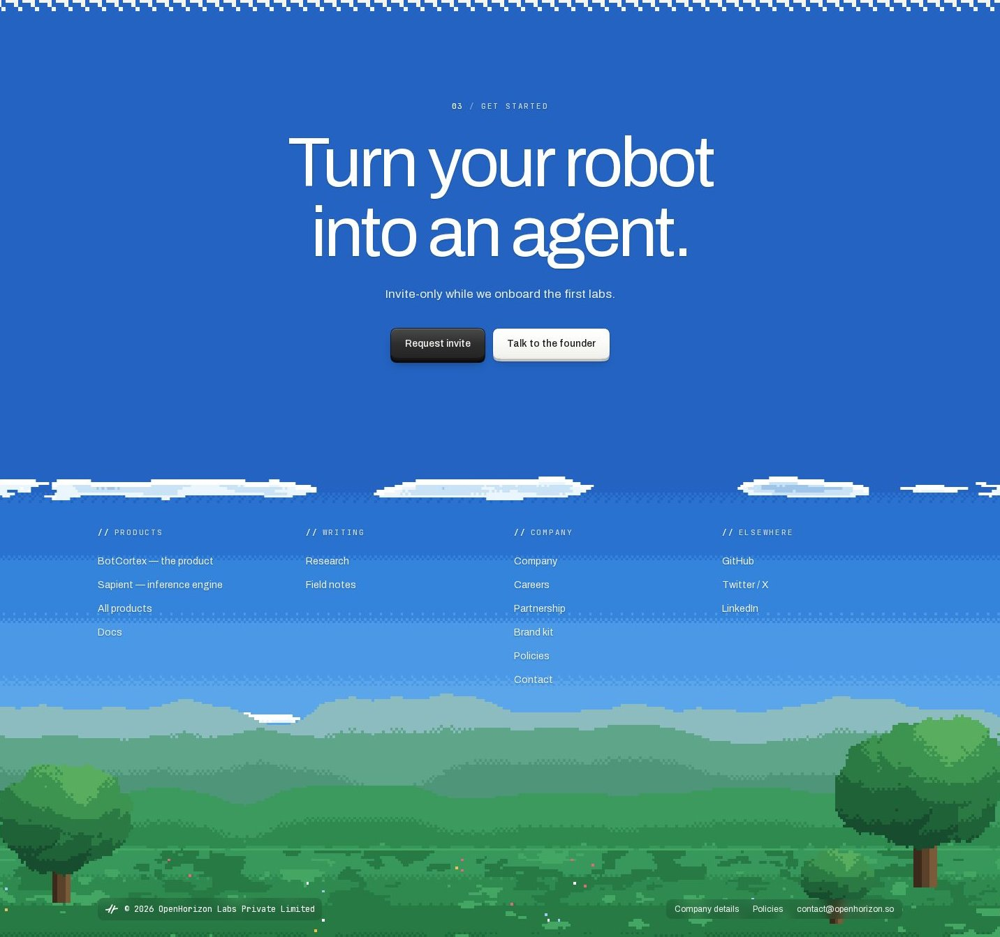

| property | value |
|---|---|
| background | `transparent` |
| color | `#171717` |
| font | `400 16px/24px` |
| family | `Archivo` |
| padding | `0px 0px 0px 0px` |
Size: 1328px tall, from 1400px wide, padding 0px × 0px.

## badge (badge, ×2)
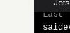
Examples: “primitive”

| property | value |
|---|---|
| background | `rgb(0 136 89 / 0.1)` |
| color | `#00794c` |
| border | `1px solid rgb(0 136 89 / 0.25)` |
| radius | `4px` |
| font | `400 10px/10px` |
| family | `JetBrains Mono` |
| padding | `2px 6px 2px 6px` |
Size: 16px tall, from 68px wide, padding 2px × 6px.

## badge-2 (badge, ×1)
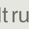
Examples: “A”

| property | value |
|---|---|
| background | `#181818` |
| color | `#ffffff` |
| radius | `10px` |
| font | `500 11px/16.5px` |
| family | `Archivo` |
| padding | `0px 0px 0px 0px` |
Size: 28px tall, from 28px wide, padding 0px × 0px.

## badge-3 (badge, ×1)
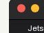
Examples: “vla”

| property | value |
|---|---|
| background | `rgb(130 84 196 / 0.1)` |
| color | `#7444b4` |
| border | `1px solid rgb(130 84 196 / 0.25)` |
| radius | `4px` |
| font | `400 10px/10px` |
| family | `JetBrains Mono` |
| padding | `2px 6px 2px 6px` |
Size: 16px tall, from 32px wide, padding 2px × 6px.

## badge-4 (badge, ×1)
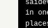
Examples: “policy”

| property | value |
|---|---|
| background | `rgb(0 121 186 / 0.1)` |
| color | `#006aaa` |
| border | `1px solid rgb(0 121 186 / 0.25)` |
| radius | `4px` |
| font | `400 10px/10px` |
| family | `JetBrains Mono` |
| padding | `2px 6px 2px 6px` |
Size: 16px tall, from 50px wide, padding 2px × 6px.

## badge-5 (badge, ×1)

Examples: “Simulation”

| property | value |
|---|---|
| background | `transparent` |
| color | `#666666` |
| border | `1px solid #dfdfdf` |
| radius | `3.35544e+07px` |
| font | `400 12px/16px` |
| family | `Archivo` |
| padding | `0px 10px 0px 10px` |
| gap | `4px` |
Size: 24px tall, from 98px wide, padding 0px × 10px.

## badge-6 (badge, ×1)

Examples: “Invite-only”

| property | value |
|---|---|
| background | `transparent` |
| color | `#6e6e69` |
| border | `1px solid #d2d2cc` |
| radius | `5px` |
| font | `400 10px/15px` |
| family | `JetBrains Mono` |
| letterSpacing | `1.4px` |
| textTransform | `uppercase` |
| padding | `2px 6px 2px 6px` |
Size: 21px tall, from 95px wide, padding 2px × 6px.

## input (input, ×1)
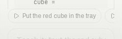
Examples: “Describe a robot task”

| property | value |
|---|---|
| background | `transparent` |
| color | `#181818` |
| font | `400 15px/22.5px` |
| family | `Archivo` |
| padding | `0px 16px 0px 16px` |
| cursor | `text` |
Size: 44px tall, from 207px wide, padding 0px × 16px.
